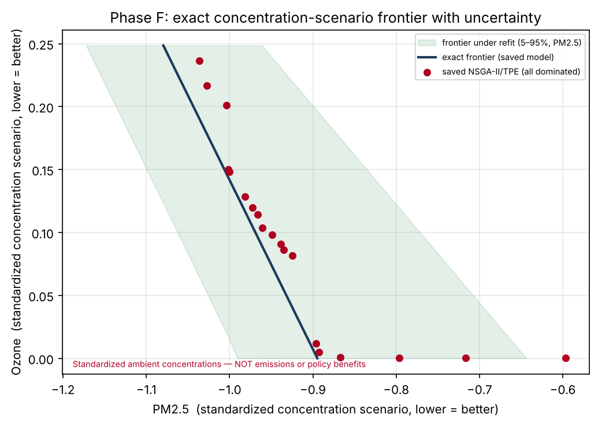

# Phase F - Model-Based Concentration-Scenario Analysis

The response model is linear in standardized ambient concentrations; its Pareto frontier is closed-form (no optimizer needed).

## Point-estimate coefficients (the SAVED model)

- ozone = -0.124·z_no
- pm25 = +0.092·z_no +0.219·z_no2 +0.228·z_co

## Refit sensitivity (complete-case vs the saved bounded/imputed fit)

- A full complete-case refit gives pm25 = +0.156·z_no +0.289·z_no2 +0.061·z_co — notably different (esp. the CO coefficient). The response coefficients are **sensitive to sampling and imputation choices**, so the frontier location is itself uncertain beyond the plotted band.

## Exact frontier endpoints (with bootstrap)

- Min-ozone scenario (z_no=0, z_no2=z_co=-2): ozone=-0.000, pm25=-0.895
- Min-pm25 scenario (z_no=z_no2=z_co=-2): ozone=+0.249 (90% CI +0.250..+0.298), pm25=-1.080 (90% CI -1.172..-0.961)

## Findings

- The frontier is a short, nearly-linear trade-off governed almost entirely by **z_no** (ozone falls as NO rises via titration; PM2.5 falls as NO/NO2/CO fall). so2 and voc are inert.
- Every saved NSGA-II/TPE policy lies **inside** (dominated by) this exact frontier (Phase B): the metaheuristic added nothing.
- The bootstrap band is the model/sampling uncertainty only; it does **not** include measurement-unit error (CO), imputation, or structural (linearity/confounding) uncertainty, which are larger.
- **Interpretation guard:** these are standardized ambient-concentration what-ifs. They are NOT emission reductions, NOT percentages, and carry NO policy-benefit interpretation. The -2σ corner may be physically infeasible (negative concentrations) and is flagged as extrapolation.

